# Engineering Roadmap: Greptech Media Academy

This document outlines the official 9-stage development lifecycle for **Greptech Media Academy**. In accordance with the project master blueprint, each stage is implemented, reviewed, tested, and approved sequentially.

---

## 🧭 Milestone Summary

```mermaid
flowchart LR
    S1["01: Frontend & UI/UX"] --> S2["02: Firebase Foundation"]
    S2 --> S3["03: Admissions System"]
    S3 --> S4["04: Auth & Roles"]
    S4 --> S5["05: Payments & Enrolment"]
    S5 --> S6["06: Student LMS"]
    S6 --> S7["07: Dashboards (Admin/Instructor)"]
    S7 --> S8["08: Certificates & Verification"]
    S8 --> S9["09: Audit & Production Deploy"]
```

---

## 📋 Granular Stage Breakdown

### Stage 01: Frontend & UI/UX Design System
* **Status**: 🟢 **Completed & Deployed**
* **Focus**: Build the full public website, design system, responsive layouts, 15 complete routes, and admissions form frontend.
* **Dependencies**: Official logo and UI design assets.
* **Deliverables**:
  - [x] Initial documentation, repository setup, and brand styling guides.
  - [x] Vite + React + TypeScript + Tailwind CSS configuration with custom theme tokens.
  - [x] Streamlined navigation with search modal, clean active states, and mobile drawers.
  - [x] Reusable design system: Header, Footer, Hero, Button, Badge, Card, Modal, Accordion, Input, ImageGallery.
  - [x] Homepage with 13 distinct cinematic sections matching design mockup.
  - [x] 15 public routes configured with React Router v6:
    - `/` (Home)
    - `/about` (About Greptech)
    - `/courses` (Courses Catalogue)
    - `/courses/:slug` (Individual Course Details for all 7 programs)
    - `/admissions` (Admissions Guide & Steps)
    - `/apply` (Admissions Application Form)
    - `/online-training` (Online & Hybrid Learning Options)
    - `/student-projects` (Student Portfolio & Showcase)
    - `/facilities` (Studios & Production Equipment)
    - `/success-stories` (Alumni Testimonials & Career Outcomes)
    - `/media` (Media Hub / Blog Articles)
    - `/media/:slug` (Article Detail Page)
    - `/contact` (Contact Form, WhatsApp, Email)
    - `/login` (Student & Instructor Login Gateway)
    - `/certificate/verify/:certificateId` (Public Certificate Verification UI)
  - [x] Professional, validated multi-step application form with passport photo preview.
* **Verification & Acceptance Criteria**:
  - Zero TypeScript build errors (`npm run build`).
  - Seamless navigation across desktop, tablet, and mobile breakpoints.
  - Functional WhatsApp link to `+234 807 756 6926` and email to `Greptechmediaacademy@gmail.com`.
  - Realistic development mock datasets clearly labeled.

---

### Stage 02: Firebase Setup & Backend Foundation
* **Status**: 🟢 **Completed**
* **Focus**: Provision Firebase environment, client SDK initialization, Local Emulator Suite configuration, and security rules baseline.
* **Dependencies**: Stage 1 completion.
* **Deliverables**:
  - [x] Firebase Web SDK (`firebase` v10+) installed.
  - [x] Centralized Firebase client configuration (`src/lib/firebase.ts`) initializing Auth, Firestore, and Storage.
  - [x] `.env.example` configured for Firebase project credentials.
  - [x] Local Firebase Emulator setup (`firebase.json` for Auth, Firestore, Storage, Functions, UI).
  - [x] Baseline Firestore Security Rules (`firestore.rules`) and Storage Security Rules (`storage.rules`).
  - [x] Typed service abstraction layer created (`src/services/admissions.service.ts`, `src/services/courses.service.ts`, `src/services/auth.service.ts`).
  - [x] Integration with admissions application form with atomic reference generation.
* **Verification & Acceptance Criteria**:
  - Verified local and production build with Firebase SDK.
  - Graceful fallback in preview mode when credentials are unconfigured.
* **Verification & Acceptance Criteria**:
  - Successful connection to Firebase Emulator Suite in local development.
  - Clean separation of development and production credentials.

---

### Stage 03: Admissions System
* **Status**: 🟢 **Completed**
* **Focus**: Implement end-to-end applicant submission, document/passport uploads to Firebase Storage, unique application ID generation, and status check portal.
* **Dependencies**: Stage 2 Firebase configuration.
* **Deliverables**:
  - [x] Application reference generator (`GMA-YYYY-XXXX`).
  - [x] Firestore schema for `applications` collection with atomic writes and server timestamps.
  - [x] Passport photo upload pipeline to Firebase Storage with size (< 2MB) and MIME-type restrictions.
  - [x] Public `/admissions/status` lookup page where applicants track review progress with email + reference.
  - [x] Admin Admissions Review Dashboard (`/admin/admissions`) with status filtering, applicant dossier, and note updates.
* **Verification & Acceptance Criteria**:
  - Validated application writes and live status queries.
  - Verified production build and Vercel routing integration.

---

### Stage 04: Authentication & Roles (RBAC)
* **Status**: ⚪ *Queued*
* **Focus**: Implement secure authentication with Role-Based Access Control for Students, Instructors, and Administrators.
* **Dependencies**: Stage 2 and 3.
* **Deliverables**:
  - Firebase Auth integration (Email/Password, Google OAuth).
  - Custom user claims for role assignment (`admin`, `instructor`, `student`).
  - Cloud Functions for secure role assignment (preventing privilege escalation from client-side).
  - Route guards / Protected Route wrapper (`<ProtectedRoute allowedRoles={['admin']} />`).
  - Auth context and session management (`useAuth()` hook).
* **Verification & Acceptance Criteria**:
  - Attempts by students to access `/admin` or `/instructor` routes redirect to unauthorized screen.
  - Custom claims validated both on client routes and in Firestore security rules.

---

### Stage 05: Payments & Enrolment
* **Status**: ⚪ *Queued*
* **Focus**: Admission offers, tuition fee payment verification, digital receipts, and automated student enrollment.
* **Dependencies**: Stage 3 (Admissions) and Stage 4 (Auth & Roles).
* **Deliverables**:
  - Admission offer issuance workflow from admin dashboard.
  - Payment gateway integration (e.g. Paystack / Flutterwave webhook verification via Cloud Functions).
  - Server-side payment verification (client never declares payment complete directly).
  - Automated cohort assignment and conversion from applicant to enrolled student account.
  - Automated digital receipt generation and email dispatch.
* **Verification & Acceptance Criteria**:
  - Webhook signatures cryptographically verified on server.
  - Enrolment records written to Firestore only upon verified settlement.

---

### Stage 06: Student Learning Portal (LMS)
* **Status**: ⚪ *Queued*
* **Focus**: Comprehensive student dashboard, lesson delivery, assignments, quizzes, attendance, and grades.
* **Dependencies**: Stage 4 (Auth) and Stage 5 (Enrolment).
* **Deliverables**:
  - Student dashboard UI (`/portal/dashboard`).
  - Course syllabus navigation and modular lesson viewer (video, text, downloads).
  - Assignment submission system with file uploads.
  - Timed interactive quizzes with server-side grading (no answers leaked to client).
  - Attendance tracking and gradebook viewer.
  - Direct communication channel / announcements from course instructors.
* **Verification & Acceptance Criteria**:
  - Students only access courses and cohorts they are enrolled in.
  - Quiz questions sent without answer keys; grading executed in Cloud Function.

---

### Stage 07: Admin & Instructor Dashboards
* **Status**: ⚪ *Queued*
* **Focus**: Operational dashboards for academy administrators and course instructors.
* **Dependencies**: Stages 3, 4, 5, 6.
* **Deliverables**:
  - **Admin Dashboard** (`/admin`):
    - Applications management: review, accept, reject, request additional information.
    - Cohort & course schedule manager.
    - Student directory and enrollment status.
    - Tuition payment reconciliation & financial summary.
    - System announcement broadcast tool.
  - **Instructor Dashboard** (`/instructor`):
    - Assigned course & cohort overview.
    - Assignment grading queue with feedback notes.
    - Attendance logging tool.
    - Student progress monitoring.
* **Verification & Acceptance Criteria**:
  - Instructors restricted to their assigned courses only.
  - Admin audit logs for sensitive actions (admission decisions, grade overrides).

---

### Stage 08: Certificates & Verification
* **Status**: ⚪ *Queued*
* **Focus**: Automated certificate generation, unique verification hashes, QR codes, and public verification portal.
* **Dependencies**: Stage 6 (LMS completion) and Stage 7 (Admin approval).
* **Deliverables**:
  - Certificate generation engine (PDF / SVG with student name, course, cohort, completion date, and verification ID).
  - Public verification route: `/certificate/verify/:certificateId`.
  - QR-code on certificate leading directly to public verification URL.
  - Admin approval gateway required prior to certificate issuance.
* **Verification & Acceptance Criteria**:
  - Public verification returns verified status, student name, course, and issuance date without exposing private student contact info.
  - Invalid certificate IDs display a clear "Certificate Not Found or Invalid" security warning.

---

### Stage 09: Testing, Security Audit & Deployment
* **Status**: ⚪ *Queued*
* **Focus**: Comprehensive end-to-end testing, security rule hardening, performance optimization, and Firebase production deployment.
* **Dependencies**: Stages 1 through 8.
* **Deliverables**:
  - Unit and integration tests (Vitest / React Testing Library).
  - Firestore Security Rules test suite using `@firebase/rules-unit-testing`.
  - Lighthouse audit ensuring 90+ score in Performance, Accessibility, Best Practices, and SEO.
  - Production Firebase deployment setup (Firebase Hosting, Cloud Functions, Firestore indexes).
* **Verification & Acceptance Criteria**:
  - All automated tests passing.
  - Zero high/critical security vulnerabilities.
  - Fast asset delivery, SSL termination, and caching headers configured.

---

## 🔒 Rules for Advancing Stages
1. **No Out-of-Order Execution**: Each stage must receive user approval before the subsequent stage is started.
2. **Commit Discipline**: Each stage must be committed to git with a clear milestone message.
3. **Verification First**: Features must be tested and demonstrated before marked complete.

