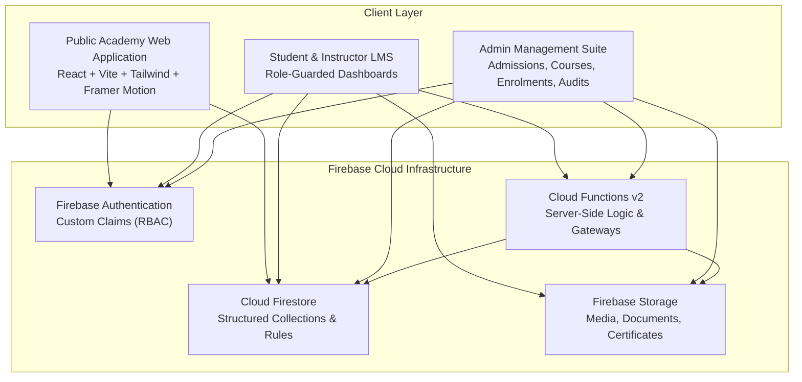
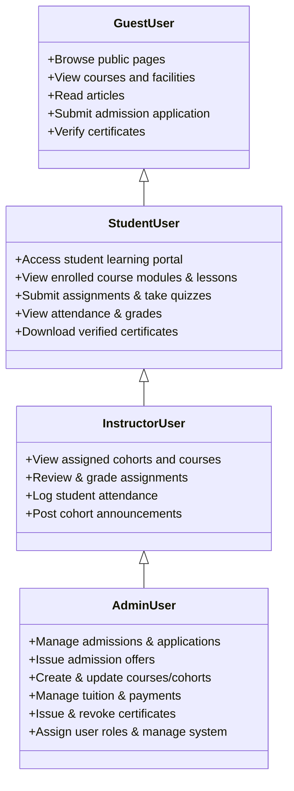

# Greptech Media Academy — Master Development Blueprint

## 1. Executive Summary & Philosophy

**Greptech Media Academy** is an elite media education institution engineered to produce industry-ready creatives. The academy offers rigorous, hands-on training across 7 core disciplines:
1. Professional Photography
2. Cinematography & Filmmaking
3. Graphic Design
4. Content Creation
5. Foley & Sound Production
6. Live Streaming & Production
7. Voiceover & Audio Production

This platform bridges the public-facing promotional presence with deep operational web applications: digital admissions, learning management, administrative governance, and cryptographic certificate verification.

---

## 2. Core Architectural Principles



### Key Engineering Rules:
1. **Never Trust the Client**: All sensitive logic (admissions reference generation, payment settlement, role assignment, quiz answer evaluation, and certificate generation) is isolated within Firebase Cloud Functions or strictly gated by Cloud Firestore Security Rules.
2. **Deterministic UI State**: The user interface is driven by TypeScript data models and explicit status enums.
3. **Progressive Enhancement**: Built as a responsive Single Page Application (SPA) with client-side routing, pre-rendering capability, and high-performance bundle chunking.
4. **Clean Code & Modular Separation**: Clear boundaries between UI components, business logic hooks, data access layers, and cloud infrastructure.

---

## 3. Technology Stack Specification

| Tier | Technology | Purpose |
| :--- | :--- | :--- |
| **Language** | TypeScript 5+ | End-to-end type safety, domain models, and compile-time contract enforcement |
| **Frontend Framework** | React 18+ | Declarative, component-driven user interfaces |
| **Build Tooling** | Vite | Ultra-fast Hot Module Replacement (HMR) and optimized Rollup distribution bundles |
| **Styling & CSS** | Tailwind CSS 3.4+ | Utility-first styling configured with custom design tokens for `#111820`, `#F56B0A`, `#F3F5F6` |
| **Icons** | Lucide React | Modern, consistent iconography matching the cinematic editorial feel |
| **Animations** | Framer Motion | Smooth, subtle page transitions, micro-interactions, and modal animations |
| **Routing** | React Router v6 | Declarative client routing, nested layouts, scroll restoration, and route guards |
| **Authentication** | Firebase Auth | Secure multi-tenant authentication, session management, and JWT custom claims |
| **Database** | Cloud Firestore | Highly scalable NoSQL document database with granular security rules |
| **Object Storage** | Firebase Storage | Cloud bucket for portfolio submissions, passport photographs, and generated certificates |
| **Compute** | Firebase Cloud Functions | Serverless Node.js / TypeScript microservices for trusted execution |
| **Security Validation** | Firebase App Check | API abuse prevention and device integrity verification |

---

## 4. Role-Based Access Control (RBAC) Model

The platform accommodates four distinct user profiles:



### RBAC Enforcement Mechanics:
- **Client Side**: Protected Route components inspect the user's decoded Firebase Auth token (`claims.role`).
- **Server Side**: Cloud Firestore Security Rules enforce access to documents based on `request.auth.token.role`:
  ```javascript
  // Example Firestore Rule Pattern
  match /grades/{gradeId} {
    allow read: if request.auth != null && (
      request.auth.token.role == 'admin' ||
      resource.data.studentId == request.auth.uid ||
      resource.data.instructorId == request.auth.uid
    );
    allow write: if request.auth != null && (
      request.auth.token.role == 'admin' ||
      request.auth.token.role == 'instructor'
    );
  }
  ```

---

## 5. Development Governance & Stage Progression

Development adheres to a 9-stage sequence. Every stage has explicit entry criteria, implementation checklists, and verification tests.

```text
STAGE 1: Frontend & Design System (Public Web & Route Setup)
   ↓ [User Verification & Approval]
STAGE 2: Firebase Setup & Foundation
   ↓ [User Verification & Approval]
STAGE 3: Admissions System
   ↓ [User Verification & Approval]
STAGE 4: Authentication & Roles
   ↓ [User Verification & Approval]
STAGE 5: Payments & Enrolment
   ↓ [User Verification & Approval]
STAGE 6: Student Learning Portal (LMS)
   ↓ [User Verification & Approval]
STAGE 7: Admin & Instructor Dashboards
   ↓ [User Verification & Approval]
STAGE 8: Certificates & Verification
   ↓ [User Verification & Approval]
STAGE 9: Testing, Security Audit & Deployment
```

No future stage may be started without explicit approval from the project owner.

