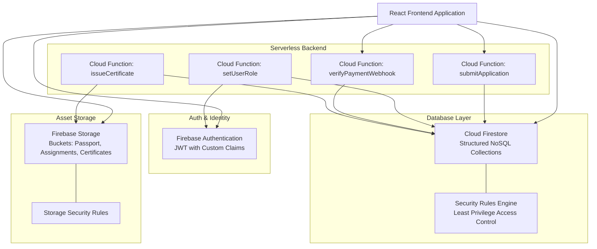

# Greptech Media Academy — Firebase Backend Architecture

This document specifies the backend cloud architecture for **Greptech Media Academy** built on the Google Firebase platform (Cloud Firestore, Firebase Authentication, Firebase Storage, Cloud Functions, and Firebase App Check).

---

## 1. Firebase Service Ecosystem



---

## 2. Cloud Firestore Schema Design

### 2.1 Collection: `users`
Stores user profile information for all accounts (Students, Instructors, Admins).
```typescript
interface UserDocument {
  uid: string;                       // Document ID = Firebase Auth UID
  email: string;
  fullName: string;
  phone: string;
  role: 'student' | 'instructor' | 'admin';
  avatarUrl?: string;
  status: 'active' | 'suspended';
  createdAt: FirebaseFirestore.Timestamp;
  updatedAt: FirebaseFirestore.Timestamp;
}
```

### 2.2 Collection: `applications`
Stores applicant records submitted via `/apply`.
```typescript
interface ApplicationDocument {
  id: string;                        // Generated Reference, e.g. GMA-2026-0814
  fullName: string;
  phone: string;
  email: string;
  dateOfBirth: string;
  residentialAddress: string;
  courseId: string;                  // e.g. "cinematography-filmmaking"
  courseName: string;
  previousExperience: 'beginner' | 'intermediate' | 'advanced';
  educationalBackground: string;
  passportPhotoUrl: string;
  passportStoragePath: string;
  emergencyContact: {
    fullName: string;
    phone: string;
    relationship: string;
  };
  privacyConsent: boolean;
  status: 'submitted' | 'under_review' | 'accepted' | 'rejected' | 'enrolled';
  adminNotes?: string;
  reviewedBy?: string;               // Admin UID
  reviewedAt?: FirebaseFirestore.Timestamp;
  createdAt: FirebaseFirestore.Timestamp;
  updatedAt: FirebaseFirestore.Timestamp;
}
```

### 2.3 Collection: `courses`
Core program definitions.
```typescript
interface CourseDocument {
  id: string;                        // Slug, e.g. "cinematography-filmmaking"
  title: string;
  shortDescription: string;
  fullOverview: string;
  category: 'visual' | 'audio' | 'design' | 'production';
  durationWeeks: number;
  format: 'in_person' | 'hybrid' | 'online';
  tuitionFee: number;                // In NGN
  currency: 'NGN';
  learningOutcomes: string[];
  equipmentProvided: string[];
  studentRequirements: string[];
  syllabusOverview: {
    week: number;
    title: string;
    topics: string[];
  }[];
  instructorId: string;
  featured: boolean;
  active: boolean;
  createdAt: FirebaseFirestore.Timestamp;
  updatedAt: FirebaseFirestore.Timestamp;
}
```

### 2.4 Collection: `cohorts`
Specific running batches of a course.
```typescript
interface CohortDocument {
  id: string;                        // e.g. "CINE-2026-Q1"
  courseId: string;
  cohortName: string;                // e.g. "Cinematography Cohort 2026A"
  startDate: FirebaseFirestore.Timestamp;
  endDate: FirebaseFirestore.Timestamp;
  capacity: number;
  enrolledCount: number;
  leadInstructorId: string;
  status: 'upcoming' | 'in_progress' | 'completed';
}
```

### 2.5 Collection: `enrollments`
Binds an approved, paid student to a specific cohort.
```typescript
interface EnrollmentDocument {
  id: string;                        // e.g. "studentId_cohortId"
  studentId: string;                 // User UID
  cohortId: string;
  courseId: string;
  enrolledAt: FirebaseFirestore.Timestamp;
  paymentStatus: 'paid' | 'partial' | 'pending';
  totalPaid: number;
  paymentReference: string;
  completionStatus: 'active' | 'graduated' | 'dropped';
}
```

### 2.6 Collection: `lessons`
Curriculum modules and lesson items.
```typescript
interface LessonDocument {
  id: string;
  courseId: string;
  cohortId?: string;                 // If cohort-specific
  moduleNumber: number;
  lessonOrder: number;
  title: string;
  contentType: 'video' | 'article' | 'assignment';
  videoUrl?: string;                 // Protected streaming link
  textContent?: string;
  attachments?: { title: string; fileUrl: string }[];
  durationMinutes: number;
}
```

### 2.7 Collection: `assignments` & `submissions`
Practical projects and submissions.
```typescript
interface AssignmentDocument {
  id: string;
  cohortId: string;
  courseId: string;
  title: string;
  brief: string;
  rubric: string[];
  dueDate: FirebaseFirestore.Timestamp;
  maxScore: number;
}

interface SubmissionDocument {
  id: string;
  assignmentId: string;
  studentId: string;
  cohortId: string;
  submissionUrl: string;             // File upload in Firebase Storage
  submittedAt: FirebaseFirestore.Timestamp;
  score?: number;
  feedback?: string;
  gradedBy?: string;                 // Instructor UID
  gradedAt?: FirebaseFirestore.Timestamp;
}
```

### 2.8 Collection: `certificates`
Official digital graduation credentials.
```typescript
interface CertificateDocument {
  id: string;                        // Public Unique Verification ID: GMA-CERT-XXXXX
  studentId: string;
  studentName: string;
  courseId: string;
  courseName: string;
  cohortId: string;
  issueDate: FirebaseFirestore.Timestamp;
  verificationHash: string;          // Cryptographic SHA-256 hash
  pdfUrl: string;                    // Firebase Storage download URL
  qrCodeUrl: string;
  status: 'valid' | 'revoked';
  revocationReason?: string;
  issuedBy: string;                  // Admin UID
}
```

---

## 3. Firebase Authentication & Custom Claims

Role-Based Access Control is enforced via JWT Custom Claims attached to the Firebase Auth token:

```typescript
// Token Claims Structure:
interface GMAAuthClaims {
  role: 'admin' | 'instructor' | 'student';
  cohorts?: string[];                // Applicable to students & instructors
}
```

### Security Rule:
- Custom claims **can never be written by client SDKs**.
- Only privileged Cloud Functions running with Firebase Admin SDK credentials may call `auth.setCustomUserClaims()`.

---

## 4. Firebase Storage Structure

```text
gs://greptech-media-academy.appspot.com/
├── applications/
│   └── {applicationId}/
│       └── passport.jpg               # Uploaded at application time
├── submissions/
│   └── {cohortId}/
│       └── {studentId}/
│           └── {assignmentId}/        # Student creative project submissions
├── certificates/
│   └── {certificateId}.pdf            # Immutable, generated graduation credentials
└── courses/
    └── {courseId}/
        └── media/                     # Course banners and syllabi downloads
```

---

## 5. Security Rules Architecture

### Core Tenet: Least Privilege
1. **Public Reads**: Only active courses, published articles, and public certificate verification records (`certificates/{id}` with limited fields) are public.
2. **User Data Isolation**: Students may only read and write their own submissions and view their own enrollment records.
3. **Instructor Access**: Instructors may only read/write grades and attendance for cohorts they are assigned to.
4. **Admin Protection**: Application review, user role alteration, course creation, and certificate issuance strictly require `request.auth.token.role == 'admin'`.

---

## 6. Cloud Functions Specification (v2)

| Function Name | Trigger | Description |
| :--- | :--- | :--- |
| `submitAdmissionsApplication` | `onCall` / HTTPS | Validates applicant schema, generates atomic application ID (`GMA-YYYY-XXXXX`), writes to Firestore, triggers confirmation email. |
| `setUserRole` | `onCall` (Admin only) | Verifies caller is admin, validates target user, sets custom claims in Firebase Auth. |
| `verifyPaymentWebhook` | HTTPS Webhook | Receives payment provider webhook, verifies signature HMAC, matches reference, sets enrollment record to paid. |
| `generateCertificatePdf` | `onCall` (Admin only) | Compiles completion data, signs cryptographic hash, renders PDF to Firebase Storage, creates public verification record. |

